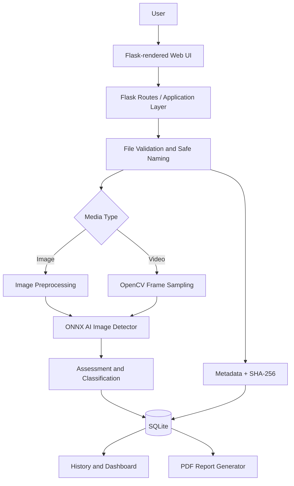
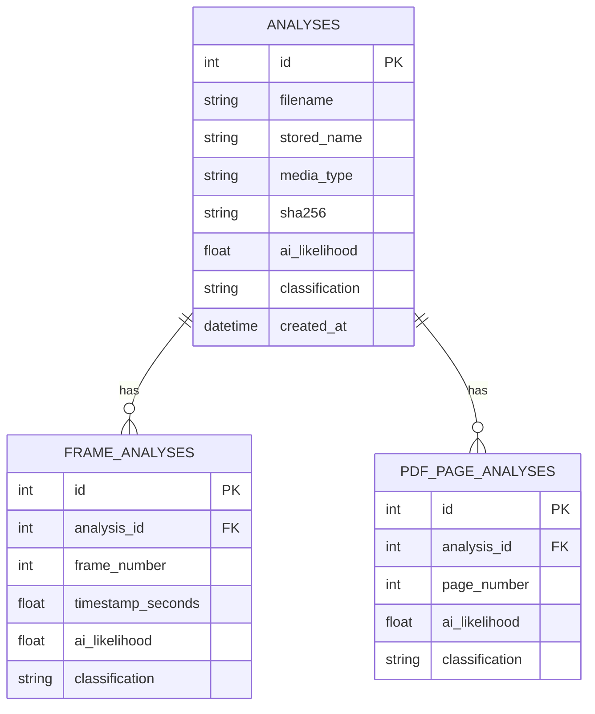

# FraudLens AI — System Design and Academic Mapping

## 1. Purpose

FraudLens AI estimates whether uploaded images are AI-generated and offers a limited video workflow by sampling frames. It supplements model inference with file metadata and SHA-256 integrity fingerprints.

## 2. Architecture

## 3. Processing flow

1. User opens `/` and reaches the dashboard directly.
2. User selects an image or video.
3. Backend validates filename extension and upload size.
4. A random UUID filename is generated.
5. Image: validate and inspect image, extract metadata, preprocess, run ONNX inference.
6. Video: read container metadata, sample up to 12 frames, run image inference on each frame.
7. Calculate the median of sampled frame scores for a video summary.
8. Calculate SHA-256 file fingerprint.
9. Store the analysis and frame records in SQLite.
10. Display results and allow PDF report download.

## 4. Detection interpretation

The selected `TensorFold/detectra-v1` model card documents a ViT-S/16 binary classifier where `sigmoid(logit)` is the estimated AI-generated probability. The project uses:
- 0–35%: Likely camera-originated
- 35–65%: Inconclusive
- 65–100%: Likely AI-generated

These are application decision bands, not a scientific guarantee. The camera-origin score is 100 minus the AI score and must not be described as independent proof of camera capture.

Video is not run through a dedicated video detector. It is a sampled-frame demonstration workflow and should be described accurately in a viva.

## 5. Database design

### analyses
- `id`: primary key
- `filename`: original safe display filename
- `stored_name`: random stored filename
- `media_type`: image or video
- `sha256`: file fingerprint
- `file_size`: bytes
- `ai_likelihood`: nullable model estimate
- `camera_likelihood`: nullable complement
- `classification`: application result
- `model_name`: model identifier
- `confidence_note`: interpretation
- `metadata_json`: extracted metadata
- `created_at`: UTC timestamp

### pdf_page_analyses
- `id`: primary key
- `analysis_id`: foreign key to analyses
- `page_number`: 1-based PDF page number
- `ai_likelihood`: model estimate
- `classification`: application label

### frame_analyses
- `id`: primary key
- `analysis_id`: foreign key to analyses
- `frame_number`: source frame index
- `timestamp_seconds`: sampled timestamp
- `ai_likelihood`: model estimate
- `classification`: threshold-based label

Relationships: one analysis has zero or many frame analyses and zero or many PDF page analyses.

## 6. ER diagram

## 7. Main routes

| Method | Route | Purpose |
|---|---|---|
| GET | `/` | Dashboard |
| POST | `/analyze` | Upload and analyze media |
| GET | `/result/<id>` | View analysis |
| GET | `/history` | List previous analyses |
| GET | `/report/<id>` | Download PDF report |
| POST | `/delete/<id>` | Delete record and file |
| GET | `/api/stats` | Dashboard statistics |
| GET | `/health` | Basic health check |

## 8. Academic subject mapping

### System Design
- Layered architecture: presentation, application, inference, data.
- Modular Python packages.
- Request/response lifecycle.
- Mermaid architecture and ER diagrams.
- API route separation.

### DBMS / RDBMS
- SQLite relational database.
- Primary key and foreign key.
- One-to-many relationship.
- SQL INSERT, SELECT, DELETE.
- Index on analysis timestamp.
- Referential integrity with cascade delete.

### Cloud Computing / DP-900
Proposed Azure extension:
- Azure App Service: host Flask web application.
- Azure Blob Storage: private uploaded-media storage.
- Azure Database for PostgreSQL: managed relational database.
- Azure Monitor: application logs and metrics.
- Azure Key Vault: secrets and credentials.

The current ZIP is local-first and does not provision these resources.

### Cloud Security
- Randomized storage filenames.
- File size and extension allow-list.
- No public upload directory route.
- Localhost-only development binding.
- Production recommendations: HTTPS, identity, CSRF protection, rate limiting, malware scanning, least privilege, private blobs, managed identity, Key Vault, backups, and retention controls.

## 9. Limitations

- The image detector may make false-positive and false-negative predictions.
- Model generalization to all new generators is not guaranteed.
- The video workflow samples frames and does not analyze temporal motion or audio.
- PDF analysis samples up to 8 rendered pages. It does not verify document text authorship, embedded digital signatures, or every page.
- Metadata may be removed or forged.
- A SHA-256 hash detects changes to a file but does not establish who created it.
- The app has no authentication by design; do not deploy publicly in this state.

## 10. Future scope

- Dedicated video deepfake detection model.
- Audio/video synchronization analysis.
- C2PA provenance verification.
- Explainable AI heatmaps from a model that supports localization.
- User authentication and role-based access.
- Azure deployment with private object storage.
- PostgreSQL migration.
- Background job queue for long videos.
- Batch media analysis.
